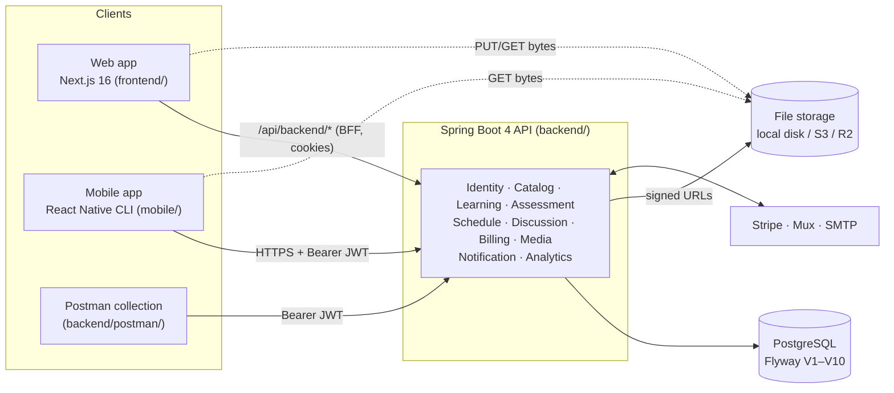
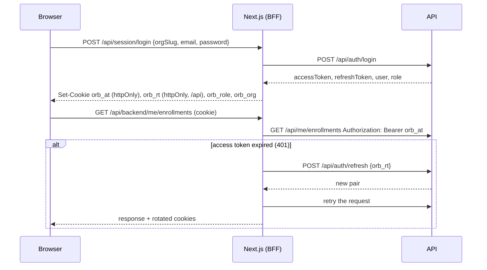
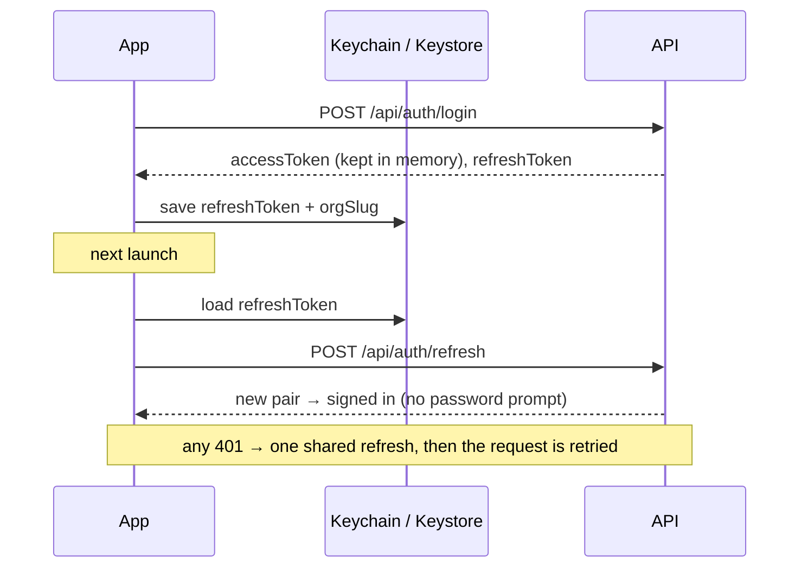
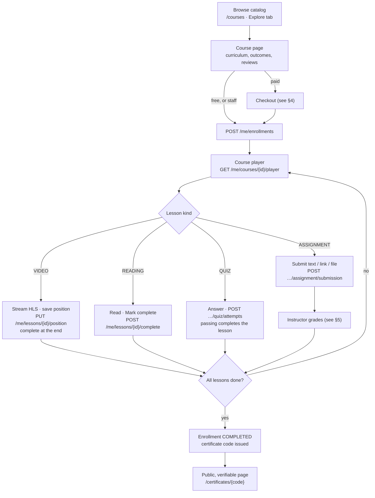
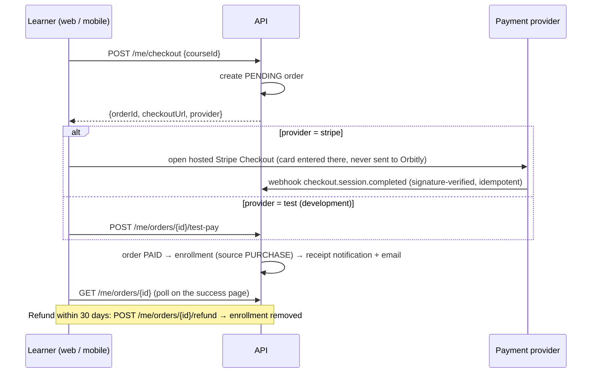
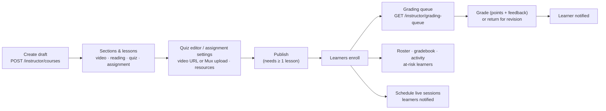
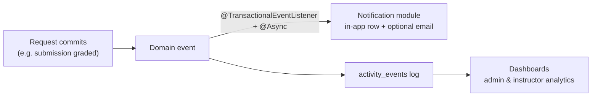
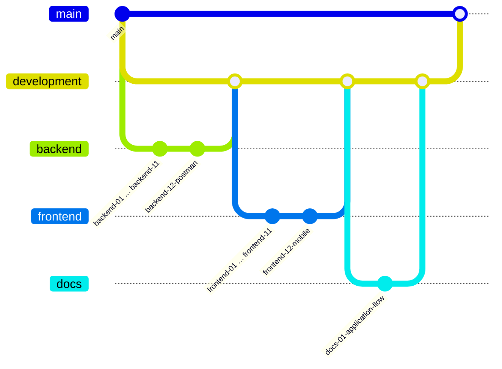

# Orbitly — application flow

How the pieces of Orbitly fit together and what happens, step by step, when people use it. For endpoint details see
[`backend/docs/API.md`](backend/docs/API.md); for running things see the [README](README.md).

## 1. The big picture

| Part | What it is | Talks to the API |
|---|---|---|
| **Web** (`frontend/`) | Public site (SEO pages, catalog, certificates) + Learn / Teach / Admin areas | Server components call the public API directly; the browser goes through the Next.js BFF at `/api/backend/*`, which adds the token from an httpOnly cookie |
| **Mobile** (`mobile/`) | Learn / Teach / Admin on iOS and Android | Directly, with `Authorization: Bearer`; refresh token kept in the Keychain / Keystore |
| **API** (`backend/`) | Modular monolith, one package per area, PostgreSQL | — |
| **Postman** (`backend/postman/`) | 101 requests that build a fresh organization and walk every flow | Directly |

### Multi-tenancy

Everything belongs to an **organization** (e.g. `northfield`). One account can be a member of several organizations
with a different **role** in each: `STUDENT`, `INSTRUCTOR` or `ADMIN`. The access token carries the current `org` and
`role`; every query is scoped to that organization. `POST /api/me/switch-organization` issues tokens for another one.

| Role | Can |
|---|---|
| Student | Browse, enroll or buy, learn, take quizzes, submit assignments, discuss, review, get certificates |
| Instructor | Everything a student can (every course free) + build and publish own courses, grade, schedule sessions, see learner analytics |
| Admin | Everything an instructor can, for every course + people, invites, seats, categories, orders and refunds, platform analytics |

## 2. Signing in

### Tokens

- **Access token** — JWT (HS256), 15 minutes, claims `sub` (user), `org`, `role`, `name`.
- **Refresh token** — opaque, 30 days, **single use**: each refresh returns a new pair. Replaying an old one revokes
  every session of that user (stolen-token protection).

### Web (BFF with cookies)

Tokens never reach browser JavaScript. `proxy.ts` sends signed-out visitors from `/learn`, `/teach`, `/admin`,
`/checkout` to `/login`, and sends people to the area their role can use.

### Mobile (Keychain)

### Other ways in

| Flow | Steps |
|---|---|
| **New organization** | `/register` → `POST /api/auth/register-organization` → the caller becomes its first admin |
| **Student self-signup** | `/signup` (web) or *Create account* (mobile) → `POST /api/auth/signup` (only if the organization allows self-signup and has free seats) |
| **Invite** | Admin `POST /api/admin/invites` → email with `/invite/{token}` → `GET /api/auth/invites/{token}` preview → `POST /api/auth/invites/accept` (new password, or the existing account's) |
| **Forgot password** | `POST /api/auth/password/forgot` (always 202) → email link `/reset-password/{token}` → `POST /api/auth/password/reset` → every session signed out |

## 3. Learner journey

Along the way:

- **Progress** — every completion recalculates `completedLessons / totalLessons`; the dashboard (`GET /me/learning/summary`) shows in-progress courses, lessons this week and minutes learned.
- **Deadlines** — quizzes and assignments with `dueAt` appear in `GET /me/deadlines`; a reminder notification goes out 24 hours before.
- **Discussion** — questions per course or lesson (`/me/courses/{id}/threads`), replies, the asker (or staff) marks the answer, staff pin.
- **Live sessions** — `GET /me/schedule` lists sessions of enrolled courses; *Join* opens the meeting link.
- **Reviews** — one per learner per course (`PUT /me/courses/{id}/review`), averaged into the course card.
- **Wishlist** — `PUT/DELETE /me/wishlist/{courseId}`.

## 4. Buying a course

Instructors and admins never pay: they enroll in any course for free.

## 5. Instructor journey

Course building happens on the **web** (`/teach/courses/{id}`: details, curriculum drag-and-drop, quiz builder,
resources, learners). The **mobile** Teach area covers what instructors do on the go: overview stats, courses with
learner progress, the grading queue (grade or return), the roster and the schedule.

## 6. Admin journey

| Task | Web | Mobile | API |
|---|---|---|---|
| Platform analytics (active learners, courses live, completion rate, seats, enrollments vs completions, activity) | `/admin` | Analytics tab | `GET /admin/analytics/overview?range=` |
| Per-course CSV report | `/admin` → Report | — | `GET /admin/analytics/report.csv` |
| Members: search, change role, suspend, remove | `/admin/people` | People tab | `/admin/members` |
| Invite people, revoke invites | `/admin/people` | People → Invite | `/admin/invites` |
| Seats, self-signup, name, logo | `/admin/settings` | — | `/admin/organization` |
| Categories and every course | `/admin/catalog` | Courses tab | `/admin/categories`, `/instructor/courses` |
| Orders, refunds, revenue | `/admin/orders` | Orders tab | `/admin/orders`, `/admin/revenue` |

Rules the API enforces: an organization always keeps at least one active admin; seat limits count active members
plus pending invites (an alert appears in activity at 90%).

## 7. Behind the scenes

### Events → notifications and analytics

Notifications are only created after the triggering transaction commits, on a background pool, so a slow mail server
never slows a request. People can turn optional emails off (`/me/notification-settings`); receipts and security
emails always go out.

### Files and video

1. `POST /api/me/uploads` (purpose, name, type, size) → `{fileId, uploadUrl, headers}` — a short-lived signed URL.
2. The client `PUT`s the bytes straight to storage (local disk in development, S3/R2 in production).
3. `POST /api/me/uploads/{fileId}/complete` checks the size and marks the file ready.

Downloads use `GET /api/me/files/{id}/download` (10-minute link). Lesson videos are either a plain URL or a Mux
upload; `GET /api/me/lessons/{id}/video` returns an HLS stream (signed for Mux), played by hls.js on the web and
natively on mobile.

### Errors

Every error is RFC 9457 `application/problem+json` with a stable `code` (e.g. `payment_required`,
`seat_limit_reached`) and a human `detail`. Web and mobile show `detail` directly.

## 8. Screens at a glance

| Area | Web (Next.js) | Mobile (React Native) |
|---|---|---|
| Public | `/`, `/courses`, `/courses/[slug]`, `/certificates/[code]` | Welcome, Explore, Course |
| Auth | `/login`, `/signup`, `/register`, `/invite/[token]`, `/forgot-password`, `/reset-password/[token]` | Sign in (+ server address), Create account, Forgot password |
| Learn | `/learn`, `/learn/browse`, `/learn/courses`, `/learn/courses/[id]`, `/learn/lessons/[id]`, `/learn/threads/[id]`, `/learn/schedule`, `/learn/grades`, `/learn/wishlist`, `/learn/orders`, `/learn/notifications`, `/learn/settings` | Home, Explore, My learning, Player, Lesson, Discussion, Thread, Schedule, Grades, Wishlist, Orders, Notifications, Certificate, Profile |
| Teach | `/teach`, `/teach/courses`, `/teach/courses/[id]`, `/teach/grading`, `/teach/grading/[id]`, `/teach/schedule` | Overview, Courses, Grading, Submission, Roster, Schedule |
| Admin | `/admin`, `/admin/people`, `/admin/catalog`, `/admin/orders`, `/admin/settings` | Analytics, People, Orders, Courses |
| Checkout | `/checkout/[orderId]/success`, `/cancel`, `/checkout/test/[orderId]` | In-app test payment, or hosted checkout in the browser |

Both clients share the design (Sora / Figtree, coral accent, Phosphor duotone icons), Light / Dark / System themes,
and the same API types (`frontend/src/lib/types.ts` ↔ `mobile/src/lib/types.ts`).

## 9. Branches

Work lands through numbered branches so the history reads in order:

Feature branches merge into `backend` or `frontend` (docs straight into `development`), those into `development`,
and `development` into `main`.
